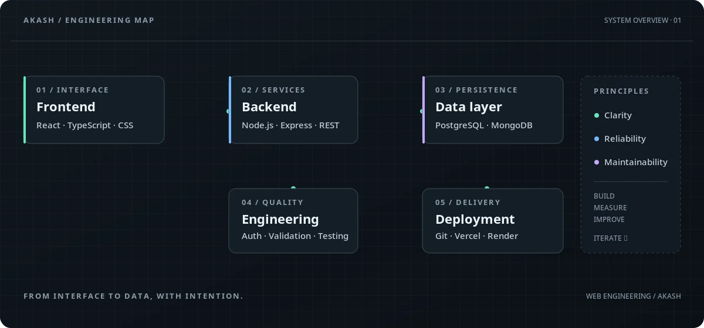

<pre>
AKASH@ENGINEERING
────────────────────────────────────
AKASH HOLSAMBRE
FULL-STACK DEVELOPER · WEB ENGINEERING
</pre>

<strong>Building from interface to API, database, and deployment.</strong>

<code>STATUS: BUILDING · LEARNING · ITERATING</code>

  

<a href="https://github.com/Beast18akash">GitHub</a>
&nbsp; · &nbsp;
<a href="https://www.linkedin.com/in/akash-holsambre-202279319/">LinkedIn</a>

---

## `01 / SYSTEM STACK`

  

<table>
  <tr>
    <td width="33%" valign="top">
      <strong>◈ LANGUAGES</strong>  
      JavaScript · TypeScript · Java
    </td>
    <td width="34%" valign="top">
      <strong>◈ FRONTEND</strong>  
      React · HTML · CSS · Tailwind CSS
    </td>
    <td width="33%" valign="top">
      <strong>◈ BACKEND</strong>  
      Node.js · Express.js · REST APIs
    </td>
  </tr>
  <tr>
    <td width="33%" valign="top">
      <strong>◈ DATA</strong>  
      MongoDB · PostgreSQL · MySQL
    </td>
    <td width="34%" valign="top">
      <strong>◈ WORKFLOW</strong>  
      Git · GitHub · Postman
    </td>
    <td width="33%" valign="top">
      <strong>◈ DEPLOYMENT</strong>  
      Vercel · Render
    </td>
  </tr>
</table>

---

## `02 / ENGINEERING MINDSET`

| PRINCIPLE | HOW I APPROACH IT |
|:--|:--|
| **Understand first** | Break down the problem before choosing an implementation. |
| **Clear boundaries** | Keep components, API routes, and data responsibilities understandable. |
| **Data integrity** | Validate input and protect correctness at application boundaries. |
| **Predictable behavior** | Handle errors deliberately and make failure states clear. |
| **Performance with purpose** | Measure bottlenecks before optimizing. |
| **Continuous iteration** | Build, test, review, and improve instead of stopping at “it works.” |

---

## `03 / SYSTEM MAP`

  

---

## `04 / CURRENTLY EXPLORING`

  
    
  <code>Prisma</code> &nbsp; <code>Docker</code> &nbsp; <code>Azure</code> &nbsp; <code>GitHub Actions</code> &nbsp; <code>GSAP</code> &nbsp; <code>Motion</code> &nbsp; <code>Three.js</code>

Currently expanding my toolkit across database tooling, containers, cloud infrastructure, automation, and motion-rich web experiences.

---

DESIGNING · BUILDING · ITERATING

